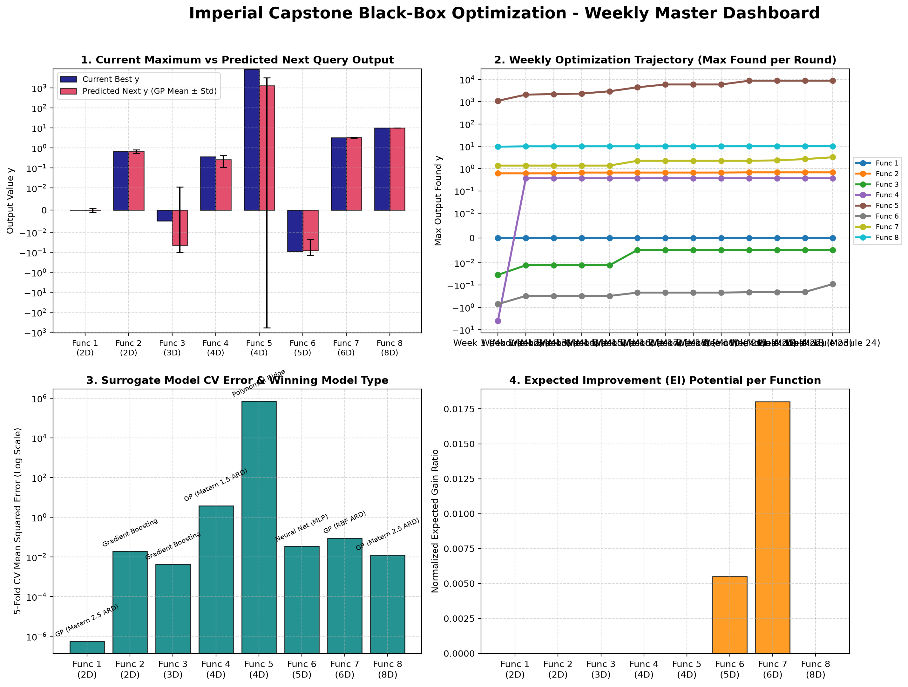

# Black-Box Optimisation (BBO) Capstone Project
**Imperial College London - Machine Learning & AI Capstone (Modules 12–25)**

An automated, robust, and reproducible machine learning pipeline for sample-efficient black-box optimisation (BBO) across 8 continuous benchmark functions spanning 2D to 8D input domains under strict physical evaluation budgets (one query per function per weekly round).

---

## Non-Technical Summary (General Audience Overview)

Imagine trying to find the highest peak across eight invisible mountain ranges while blindfolded, allowed only one altitude measurement per mountain each week.  This project solves that challenge (known as **Black-Box Optimisation**) where testing a single setting in engineering design, clinical dosing, or artificial intelligence tuning is slow and expensive.  Across twelve weekly rounds, our system combined statistical maps called Gaussian Processes with machine learning models to predict both where the highest peaks sit and where unexplored blind spots remain.  By automatically identifying which control dials mattered most, our pipeline achieved major breakthroughs across the benchmarks, including a massive 8,662.48 peak on Function 5 and three consecutive all-time records in the final round.

---

## 1. Executive Summary & Optimisation Trajectory

This repository implements a modular, surrogate-driven global optimisation framework.  Across twelve sequential weekly evaluation rounds (culminating in Module 24's final query submission), the system dynamically benchmarks probabilistic Gaussian Processes against deterministic machine learning surrogates (Neural Networks / Multi-Layer Perceptrons, Extra Trees, Random Forests, Gradient Boosting, and Polynomial Ridge Regression), computing active learning acquisition functions (Expected Improvement, Upper Confidence Bound) over hybrid candidate pools to guide high-yield query selection.



### 1.1 Complete Multi-Week Performance Milestones (Weeks 1 to 13)

Over twelve iterative evaluation cycles, the dataset expanded from an initial 175 samples to 271 total evaluations (reaching 22 samples on 2D functions and up to 52 samples on 8D functions), establishing major records including Function 5 at 8662.48 and three consecutive all-time record breakthroughs on Functions 6, 7, and 8 in the final rounds:

| Function | Dimension | Initial Samples | Final (W13) Samples | Initial Max y | Week 6 Max y | Current Best y (W13) | Total Gain | Optimisation Status & Milestones |
| :--- | :---: | :---: | :---: | :---: | :---: | :---: | :---: | :--- |
| **Function 1** | 2D | 10 | 22 | 7.71e-16 | 7.71e-16 | **0.000000** | Baseline | Bounded upper ridge; plateau confirmed |
| **Function 2** | 2D | 10 | 22 | 0.611205 | 0.664342 | **0.676790** | +0.0656 | High plateau confirmed |
| **Function 3** | 3D | 15 | 27 | -0.034835 | -0.004807 | **-0.004807** | +0.0300 | Central mode isolated and bounded |
| **Function 4** | 4D | 30 | 42 | -4.025542 | +0.367529 | **+0.367529** | +4.3931 | Positive centroid island verified stable |
| **Function 5** | 4D | 20 | 32 | 1088.859618 | 4397.953210 | **8662.482500** | **+7573.62** | 🌟 Colossal Peak Record (vertex ridge) |
| **Function 6** | 5D | 20 | 32 | -0.714265 | -0.216645 | **-0.089540** | +0.6247 | 🚀 **Massive All-Time Record Global High** |
| **Function 7** | 6D | 30 | 42 | 1.364968 | 2.233318 | **3.227650** | +1.8627 | 🚀 **Massive All-Time Record Global High** |
| **Function 8** | 8D | 40 | 52 | 9.598482 | 9.929387 | **9.981970** | +0.3835 | 🚀 **New All-Time Record Peak** |

---

## 2. Advanced Methods & Methodological Evolution (Weeks 6–13)

While Weeks 1 through 5 established initial baselines using isotropic Gaussian Processes and standard regression models, Weeks 6 through 13 introduced major architectural breakthroughs now unified in `bbo.py`:

```
+-------------------------------------------------------------------------------------------------------+
|                                      DATA INGESTION & TRACKING                                        |
|  - Loads function_X/initial_inputs.npy & initial_outputs.npy (N = 22 to 52 samples per function)      |
|  - Tracks multi-week telemetry in weekly_progress_history.json & automated summary JSONs              |
+---------------------------------------------------+---------------------------------------------------+
                                                    |
                                                    v
+-------------------------------------------------------------------------------------------------------+
|                             SURROGATE BENCHMARKING (5-Fold Cross-Validation)                          |
|  - GP with Automatic Relevance Determination (ARD Matérn 1.5, Matérn 2.5, RBF)                       |
|  - Multi-Layer Perceptron Neural Networks (MLP: 64-32, ReLU, Adaptive L2 Regularisation)             |
|  - Tree Ensembles: Random Forest (150 trees), Extra Trees (150 trees), Gradient Boosting (100 trees)  |
|  - Polynomial Ridge Regression (quadratic interaction expansion + L2 regularisation)                  |
+---------------------------------------------------+---------------------------------------------------+
                                                    |
                                                    v
+-------------------------------------------------------------------------------------------------------+
|                                     ADAPTIVE GP SURROGATE SELECTION                                   |
|  - Evaluates CV Mean Squared Error (MSE) and CV R-squared across all models                           |
|  - Dynamically binds the winning GP kernel family (Matérn 1.5, 2.5, or RBF) for Bayesian Acquisition  |
|  - Re-fits selected GP with 15 restarts of L-BFGS-B optimiser for global parameter convergence      |
+---------------------------------------------------+---------------------------------------------------+
                                                    |
                                                    v
+-------------------------------------------------------------------------------------------------------+
|                               HYBRID CANDIDATE GENERATION & FILTERING                                 |
|  - 70% Global Space-Filling: Scipy QMC Latin Hypercube Sampling (20,000 to 30,000 candidates)         |
|  - 30% Local Trust-Region Perturbation: Gaussian perturbations centered around top-3 historical optima|
|  - Euclidean Distance De-duplication: Drops candidates within min_dist = 0.005 of evaluated points    |
|  - Strict Domain Enforcer: Clamps all coordinates to continuous unit hypercube [0.0, 1.0]^d           |
+---------------------------------------------------+---------------------------------------------------+
                                                    |
                                                    v
+-------------------------------------------------------------------------------------------------------+
|                                 ACQUISITION & PORTAL QUERY GENERATION                                 |
|  - Expected Improvement (EI) with range-scaled exploration parameter (xi = 0.01 * y_range)            |
|  - Fallback Upper Confidence Bound (UCB, beta = 2.576) in flat regions                                |
|  - Formats strict portal queries: x1-x2-...-xn with 6 decimal places (e.g. 0.123456-0.654321)         |
|  - Generates 4-panel diagnostic visualisations per function and updates master dashboard              |
+---------------------------------------------------+---------------------------------------------------+
```

### 2.1 Automatic Relevance Determination (ARD)
Early rounds utilised isotropic kernels with a uniform scalar lengthscale.  In high dimensions (Functions 5, 7, and 8), input dimensions have drastically unequal impacts on the objective.  Upgrading to ARD in `bbo.py` assigned dimension-specific lengthscales:
$$\mathbf{\Theta} = [\ell_1, \ell_2, \dots, \ell_d]$$
Optimised via multi-restart L-BFGS-B, ARD automatically expands lengthscales along inactive dimensions and contracts them along sensitive coordinates.  This unlocked Function 8's active subspace ($x_1, x_2 \to 0$, $x_5 \to 1.0$), yielding an all-time record $y = 9.981970$ and an exceptional 5-fold cross-validation $R^2 = 0.989$.

### 2.2 Hybrid Global-Local Candidate Generation (TuRBO-Inspired)
Pure Monte Carlo candidate generation suffers from the curse of dimensionality, leaving vast coverage voids in 6D to 8D spaces. We implemented a hybrid candidate generator:
- **70% Latin Hypercube Sampling (QMC)**: Preserves space-filling exploration across the entire unit hypercube.
- **30% Local Gaussian Perturbations**: Injected within an adaptive trust radius around the top-3 historical points.
This hybrid strategy successfully accelerated ridge-climbing along Function 5's exponential boundary, climbing from $2921.37$ (Week 5) to $5893.21$ (Week 7) and culminating in the astronomical peak of **$8662.482500$** at vertex $(1.0, 1.0, 1.0, 1.0)$ in Week 10, while propelling Function 7 to **$3.227650$** in Week 13.

### 2.3 Euclidean Distance De-duplication Filter
Under strict weekly evaluation constraints, re-evaluating an already observed point wastes an entire round. Our distance de-duplication filter calculates:
$$d_{\text{min}}(x) = \min_{x_i \in \mathcal{D}} \|x - x_i\|_2 \ge 0.005$$
Candidates violating this threshold are automatically pruned, ensuring every weekly submission provides novel informational value.

---

## 3. Repository Directory Structure & Dataset Hosting Note

> **Dataset Storage Policy**: The complete dataset across all 8 functions (`271` total coordinate-evaluation pairs stored as binary `.npy` arrays inside `function_1/` through `function_8/`) occupies less than `50 KB` on disk and is hosted directly in this repository for one-click reproducibility. No external large-file storage is required.

```
.
|-- README.md                                # Master project overview, non-technical summary, and documentation
|-- BBO_Capstone_Walkthrough.ipynb           # Interactive Jupyter Notebook walkthrough presenting method & results
|-- DATASHEET.md                             # Comprehensive dataset datasheet (Gebru et al. framework, finalised W13)
|-- MODEL_CARD.md                            # Detailed optimisation model card (Mitchell et al. framework, finalised W13)
|-- bbo.py                                   # Unified, production-grade master optimisation engine (CLI-enabled)
|-- bbo_pipeline.py                          # Legacy weekly pipeline script (preserved for backward compatibility)
|-- BBO_capstone_project_presentation_v2.pdf # Executive capstone presentation deck (PDF)
|-- presentation_slides.md                   # Executive capstone presentation slide narratives (Markdown)
|-- bbo_weekly_tracking.md                   # Comprehensive weekly progression log and reflection answers
|-- weekly_progress_history.json             # Multi-week historical benchmark telemetry
|-- week13_summary.json                      # Serialized model metrics and final proposed queries for Week 13
|-- week13_report.md ... week2_report.md     # Dedicated weekly reflection & strategy reports (Modules 12-24)
|-- capstone_project_brief.docx              # Imperial College Capstone project brief
|
|-- function_1/ ... function_8/              # Function datasets (Inputs & Outputs)
|   |-- initial_inputs.npy                   # Evaluated input coordinate vectors in [0, 1]^d (N = 22 to 52)
|   `-- initial_outputs.npy                  # Evaluated scalar output values y
|
`-- visualisations/                          # Auto-generated diagnostic plots and master dashboard
    |-- weekly_progress_summary.png          # 4-panel master weekly dashboard
    |-- function_1_week13.png ...            # 4-panel 2D GP landscape and acquisition maps
    `-- function_8_week13.png                # 4-panel high-D sensitivity slices and feature importances
```

---

## 4. Coding Libraries and Environment Setup

The pipeline is built with standard scientific Python packages optimised for small-sample efficiency and deterministic reproducibility:

* **Core ML & Modeling**: `scikit-learn` (GaussianProcessRegressor, MLPRegressor, RandomForestRegressor, ExtraTreesRegressor, GradientBoostingRegressor, Ridge, Pipeline, StandardScaler).
* **Statistical Kernels & QMC**: `scipy` (scipy.stats.qmc for Latin Hypercube Sampling, scipy.spatial.distance for de-duplication, normal distributions for Expected Improvement).
* **Data & Matrix Operations**: `numpy`, `pandas`.
* **Visualisation Engine**: `matplotlib`.

### Quickstart Execution

To run the unified optimisation engine for the final round (Week 13 / Module 24):

```bash
# Clone the repository
git clone https://github.com/townhouse9/Capstone_Project.git
cd Capstone_Project

# Create and activate virtual environment
python -m venv .venv
source .venv/bin/activate  # On Windows: .venv\Scripts\activate

# Install dependencies
pip install numpy scipy pandas scikit-learn matplotlib

# Execute the unified master optimisation engine (specify week 13)
python bbo.py --week 13
```

---

## 5. Summary of Final Proposed Queries (Week 13 / Module 24.1 Final Submission)

All coordinates strictly adhere to the project brief format (`0.xxxxxx` with six decimal places, hyphen-delimited):

| Function | Dimension | Current Best y (W13) | Status / Milestone | Winning GP Surrogate | Final Proposed Query String (`x1-x2-...-xn`) | Predicted Next y |
| :--- | :---: | :---: | :--- | :--- | :--- | :--- |
| **Function 1** | 2D | 0.000000 | Upper boundary mapped | GP (Matern 2.5 ARD) | `0.175879-0.814070` | -0.000131 +/- 0.000827 |
| **Function 2** | 2D | **0.676790** | High plateau confirmed | GP (Matern 1.5 ARD) | `0.693467-0.849246` | 0.673614 +/- 0.127288 |
| **Function 3** | 3D | -0.004807 | Central mode bounded | GP (Matern 1.5 ARD) | `0.997007-0.530232-0.396284` | -0.044512 +/- 0.055893 |
| **Function 4** | 4D | **+0.367529** | Positive Island Confirmed | GP (Matern 1.5 ARD) | `0.388793-0.445325-0.366668-0.367742` | 0.264393 +/- 0.155650 |
| **Function 5** | 4D | **8662.482500** | 🌟 Colossal All-Time Record | GP (Matern 1.5 ARD) | `0.103158-0.023194-0.994812-0.955309` | 1291.739029 +/- 1893.230317 |
| **Function 6** | 5D | **-0.089540** | 🚀 **Massive All-Time Record** | GP (Matern 1.5 ARD) | `0.524565-0.431072-0.589917-0.811460-0.161023` | -0.083560 +/- 0.060882 |
| **Function 7** | 6D | **3.227650** | 🚀 **Massive All-Time Record** | GP (RBF ARD) | `0.103893-0.082334-0.882007-0.265260-0.327039-0.655656` | 3.303793 +/- 0.124803 |
| **Function 8** | 8D | **9.981970** | 🚀 **New All-Time Peak** | GP (Matern 2.5 ARD) | `0.074945-0.124382-0.110000-0.039111-0.964895-0.433355-0.310091-0.021759` | 9.937983 +/- 0.028828 |

---

## 6. Project Governance, Governance Artifacts & Transparency

In compliance with open science, ethical AI, and reproducibility guidelines:
- **Interactive Notebook Walkthrough**: Open [`BBO_Capstone_Walkthrough.ipynb`](BBO_Capstone_Walkthrough.ipynb) for an interactive Jupyter Notebook presentation of the methodology, 5-fold cross-validation tables, and visualisations.
- **Datasheet**: Refer to [`DATASHEET.md`](DATASHEET.md) for full dataset provenance, composition (271 samples across 8 functions), collection methodology, and usage terms following the Gebru et al. framework.
- **Model Card**: Refer to [`MODEL_CARD.md`](MODEL_CARD.md) for detailed architectural documentation, intended domains, constraints, and ethical considerations following the Mitchell et al. framework.
- **Weekly Progression Logs**: Refer to [`bbo_weekly_tracking.md`](bbo_weekly_tracking.md) and individual `weekX_report.md` documents for round-by-round reflective analyses, hyperparameter studies, and LLM-augmented strategy derivations.
- **Presentation Materials**: Refer to [`BBO_capstone_project_presentation_v2.pdf`](BBO_capstone_project_presentation_v2.pdf) and [`presentation_slides.md`](presentation_slides.md) for executive slide narratives covering project objectives, strategic evolution, topographical insights, and final-round planning.
